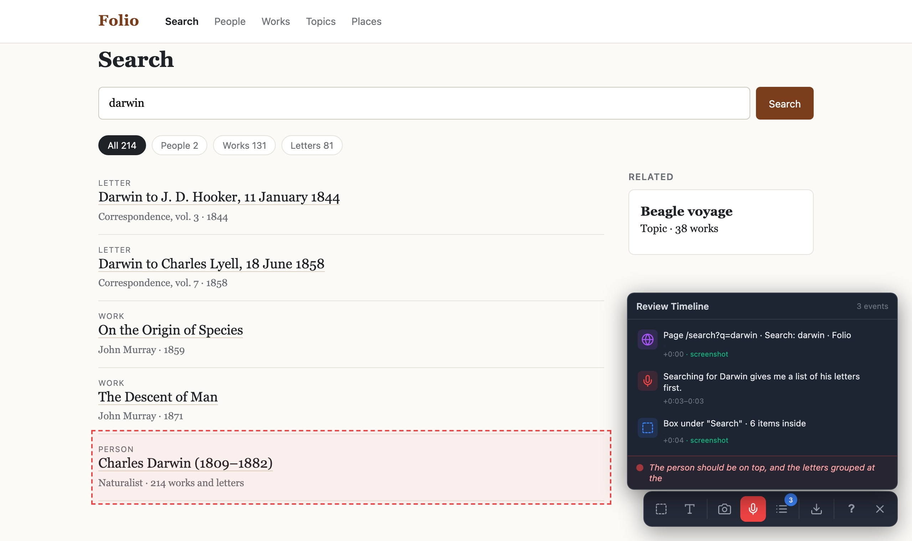

# Webapp Reviewer

Review a web app by talking through it and pointing at things. The extension records what you say, what you click, the areas you box and the text you select, with screenshots and the DOM context of each. It saves everything as one review folder that a coding agent such as Claude Code can read and act on.



## Reviewing

Start a review from the extension icon or with `Alt+R`, then use the app as you normally would and say what you think.

- **Talk.** Speech is transcribed live and placed by when you said it, between the clicks and page changes around it.
- **Click** what you are talking about. The agent gets the element, where it sits on the page, and a screenshot with it outlined.
- **Option-drag** to box an area. The agent gets a cropped screenshot and an outline of the headings, links, controls and text inside it.
- **Select text** to quote exact wording, such as a typo.
- **Move around freely.** The review continues across page loads, and every page is screenshotted after it loads.

Press `Alt+X` to export. The review is saved to `~/.claude/reviews/review-<time>/` and the path of its `review.md` is copied to the clipboard. In Claude Code, run `/webapp-reviewer`, or paste the path and ask it to work through the review.

| Shortcut | Action |
|---|---|
| `Alt+R` | Start or stop the review |
| Option + drag | Box an area |
| `Alt+T` | Type a note instead of talking |
| `Alt+S` | Screenshot the whole screen |
| `Alt+N` | Show what has been recorded |
| `Alt+X` | Export |
| `?` | Help |

## What the agent gets

`review.md` is written for a model to read:

- **Pages**: every page visited, when, how many remarks were made there, and its screenshot.
- **Transcript**: everything you said, unbroken, with your actions as markers where they happened:
  > The search should put the person first, [+0:06 box under "Search results"] not a list of his letters.
- **Timeline**: each event in detail. Clicks and boxes come with their element (React or Vue component and source file in dev builds, test id, nearest heading, selector) and a screenshot. Each page visit records how you got there and how long it took to load. Link clicks show their target, and whether a page load followed. Dropdown and text field changes are recorded, and so is time spent on another tab.

The folder also has `timeline.json` (the same events as data), page and click screenshots at CSS pixel size, and `console.log` with console errors, uncaught exceptions and failed requests.

`SKILL.md` is the Claude Code skill that tells the agent how to read a review.

## Install

You need a Chromium-based browser (Chrome, Chromium, Brave or Edge) on macOS or Linux, and Node.js. Voice needs a [Soniox](https://soniox.com) API key; this is a paid service. Without a key you can still click, box, select and type notes.

```bash
git clone https://github.com/houshuang/webapp-reviewer.git
cd webapp-reviewer
./install.sh
```

The install script:
- links the folder into `~/.claude/skills`;
- registers the native messaging host that writes reviews to disk;
- creates `.env`, where you add `SONIOX_KEY=...`.

Then open `chrome://extensions`, turn on Developer mode, choose **Load unpacked** and select the `extension` folder. The extension ID is fixed, so the native host registration matches it on every machine.

After pulling changes, click the reload icon on the extension's card.

## Privacy

The extension runs on every site, but records only while a review is active in that tab. It needs microphone access for voice. Audio is streamed to Soniox for transcription. Everything else stays on your machine in `~/.claude/reviews`: screenshots, page details and console output. The extension requests access to all sites. It needs that to keep reviewing after a page load and to read the page's console.

## Development

- `npm test` runs the export tests against a made-up review in `test/fixtures`.
- `bin/rebuild-review [review folder]` rewrites a saved `review.md` from its `timeline.json` with the current export code, which is useful after changing the export.
- `bin/start` serves the saved reviews at `http://localhost:10002/reviews`. You only need it for browsing reviews; recording and saving work without it.
- `docs/screenshot.js` regenerates the README screenshot.

## License

MIT
